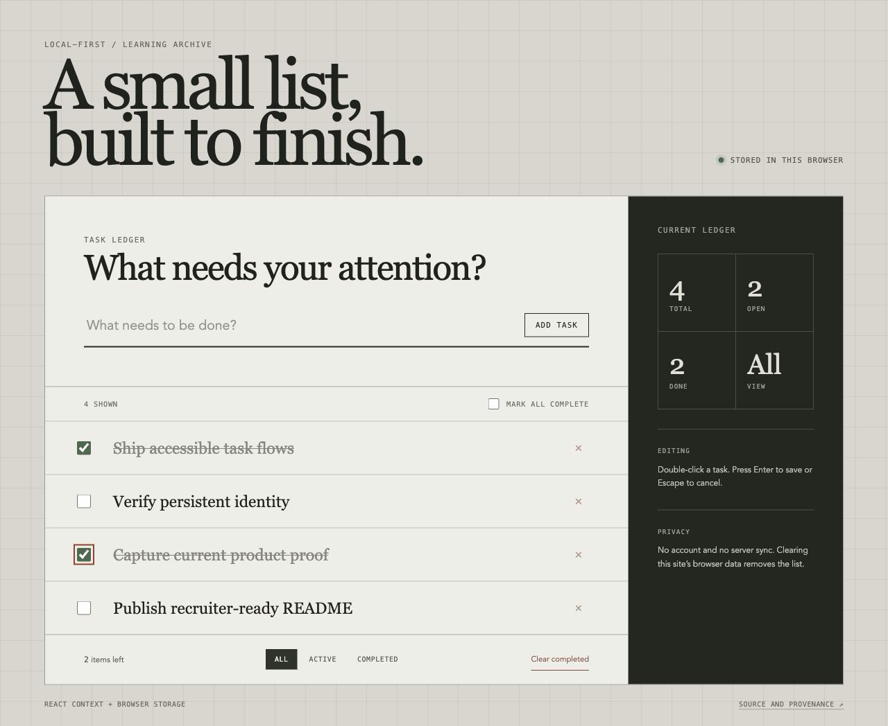

# Task Ledger

A local-first React task workspace with stable task identity, keyboard editing, filtering, and browser persistence. It is intentionally presented as a learning archive: compact in scope, but explicit about the behavioral bugs and accessibility details that make small interfaces trustworthy.

[Open the live Task Ledger](https://todo-app-react-elk.pages.dev/)



## What the current version proves

- Adds, completes, filters, edits, deletes, and clears tasks through accessible controls.
- Assigns each task a stable identifier, so acting on a filtered result always updates the intended persisted task.
- Focuses and selects the inline editor; Enter saves, Escape cancels, and saving an empty edit removes the task.
- Migrates older browser records without identifiers and recovers safely from malformed storage.
- Shows explicit empty, filtered, completion, and browser-only persistence states.
- Uses a responsive authored interface with reduced-motion support and no external visual assets or font requests.

## Origin and provenance

The project began as the Patika Front End Bootcamp week 12 React assignment, following the TodoMVC-style application by [Dmitry Sharabin](https://codepen.io/dmitrysharabin/pen/MWgQNYZ). That origin remains part of the project history rather than being hidden.

The current Task Ledger presentation, stable-ID data model, defensive storage migration, keyboard editing behavior, accessible controls, tests, metadata, and CI were implemented in this repository. The original interaction recording is preserved below as a before-state artifact.

## Architecture

- `TodoProvider` owns tasks, filters, persistence, migration, and mutations.
- `useTodos` exposes the context through one guarded consumer hook.
- `Header`, `TodoList`, `TodoItem`, and `Footer` keep input, collection, item, and filter concerns separate.
- React Testing Library drives the same labeled controls exposed by the public UI.

Tasks are stored under the browser-local `todos` key as objects with `id`, `text`, and `done` fields. There is no account, backend, analytics pipeline, or cross-device sync. Clearing this site’s browser data removes the list.

## Verification

The behavior suite covers filtered-list identity, add/complete/filter/clear flows, edit saving and cancellation, empty-edit removal, and malformed-storage recovery. CI runs those checks before linting and producing the deployment build.

```sh
# Node.js 20.19 or newer
npm ci
npm test
npm run lint
npm run build
```

## Earlier iteration

<details>
<summary>Original bootcamp interaction recording</summary>


</details>
